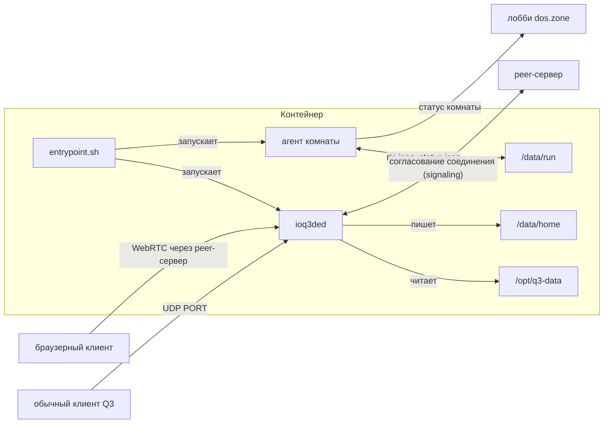

# Контейнер: компоненты, пути, тома

Проверено запуском на `20261112-d608e3a-stock`, `20261112-c64186e-cpma`, `20261114-9e899840-osp`.

## Компоненты



[Entrypoint](../README.md) проверяет [ENV](env.md) и запускает два процесса: ioq3ded ведёт игру, а агент комнаты публикует комнату в [лобби dos.zone](../glossary.md#лобби); браузерные игроки приходят через [peer-сервер](../glossary.md#peer-сервер), обычные клиенты Q3 подключаются напрямую по UDP.

Если любой из двух процессов завершается, entrypoint останавливает второй, и контейнер выходит с ненулевым кодом. Проверено запуском на [stock](../glossary.md#stock). Когда агент комнаты убит `kill` внутри контейнера, ioq3ded пишет `Server Shutdown (Received signal 15)` и контейнер выходит с кодом 143. Когда убит ioq3ded, код выхода 1, а при занятом порте код 3. При `RUN_ROOM_AGENT=0` агента нет, см. [env.md](env.md#run_room_agent).

## Каталоги

`<мод>` в путях означает каталог игры: `demoq3` у stock, `cpma` у [CPMA](../glossary.md#cpma), `osp` у [OSP](../glossary.md#osp).

| Путь | Что лежит | Запись | Переживает пересоздание | Что сюда монтировать |
|---|---|---|---|---|
| `/app` | `entrypoint.sh`, `ioq3ded.x86_64`, агент комнаты и его шаблон `dedicated_room_agent.toml`, [каталог карт](../glossary.md#каталог-карт) `maps.txt`, `runtime-manifest.txt` | только чтение | меняется только с [тегом](../glossary.md#тег) [образа](../glossary.md#образ) | ничего |
| `/opt/q3-data/<мод>`, `/opt/q3-data/baseq3` | файлы игры и [мода](../glossary.md#мод) из образа | только чтение | меняется только с тегом образа | [`autoexec.cfg`](../glossary.md#autoexeccfg) в `/opt/q3-data/<мод>/autoexec.cfg`, только `:ro` |
| `/data/home` | домашний каталог движка ([`fs_homepath`](../glossary.md#fs_homepath)), куда пишет сервер | запись, том | да, пока том тот же | ничего, это именованный том |
| `/data/run` | файлы агента комнаты: `dedicated_room_agent.runtime.toml`, [`rtc.json`](../glossary.md#rtcjson), [`status.json`](../glossary.md#statusjson) | запись, том | да, пока том тот же | ничего, это именованный том |
| `/data/custom/demoq3` | stock: свои [PK3](../glossary.md#pk3) с картами (`fs_custompath`) | только чтение | | каталог с вашими PK3, `:ro`; см. [свои карты stock](../recipes/stock-custom-maps.md) |
| `/data/maplist.txt` | список карт (stock, CPMA) | | | файл `maplist.txt`, `:ro`; OSP его не читает |

Сервер работает от пользователя `q3` (uid 65532). Каталоги `/data/run` и `/data/home` должны быть доступны ему на запись, иначе [отказ](../glossary.md#отказ-при-старте) `RUN_DIR and HOME_DIR must be writable`. Именованный том Docker получает права из образа сам. Если вместо тома монтируете каталог [хоста](../glossary.md#хост), назначьте владельцем этого каталога пользователя с uid 65532.

Файлы в `/data/home/<мод>` движок находит раньше файлов `/opt/q3-data/<мод>`, поэтому файл в `/data/home` скрывает одноимённый файл образа. Подробно порядок описан в [layers.md](layers.md#какой-файл-читается).

CPMA и OSP при каждом старте сверяют каждый файл `/opt/q3-data` с хешами из `/app/runtime-manifest.txt`. Изменённый файл образа останавливает запуск примерно через 9 секунд после старта, код выхода 1:

```
CPMA packaged data hash verification failed
```

У OSP сообщение то же. Проверено запуском на CPMA со своим [`cpma.cfg`](../glossary.md#конфиг-мода), [смонтированным](../glossary.md#смонтированный-файл) поверх `/opt/q3-data/cpma/cpma.cfg`. Ваш `autoexec.cfg` в манифест не входит и проверку не нарушает.

## Bind-монтирование отсутствующего файла

Файл с хоста монтируется (bind-монтирование) строкой в `volumes:`, где слева путь на хосте. Если такого файла на хосте нет, Docker создаёт на его месте пустой каталог с владельцем root. Для `maplist.txt` (stock и CPMA) entrypoint тогда останавливается, код выхода 1:

```
/data/maplist.txt is not a file: is maplist.txt missing next to compose.yaml?
```

Удалите созданный Docker каталог (`sudo rmdir maplist.txt`), положите файл рядом с `compose.yaml` и запустите снова.

## Файлы, которые создаёт и удаляет сервер

| Файл | Мод | Кто и когда | Чем менять | Ручная правка |
|---|---|---|---|---|
| `/data/run/dedicated_room_agent.runtime.toml` | все | entrypoint, каждый старт при `RUN_ROOM_AGENT=1`: шаблон из `/app`, [alias](../glossary.md#alias) и `CLOUD_BASE_URL` | `NET_SERVER_NAME`, `CLOUD_BASE_URL` | теряется при каждом старте |
| `/data/run/rtc.json` | все | при `RUN_ROOM_AGENT=1` entrypoint удаляет его на каждом старте, агент пишет новый; при `0` файл должен уже лежать и быть непустым, тогда он сохраняется и после [рестарта](../glossary.md#рестарт-контейнера), и после [пересоздания](../glossary.md#пересоздание-контейнера) | | при `RUN_ROOM_AGENT=1` теряется на каждом старте |
| `/data/run/status.json` | все | удаляется на каждом старте при любом `RUN_ROOM_AGENT`, пишет сервер, читает агент | `HOSTNAME`, `VPS_DEDICATED_IMAGE` | теряется |
| `/data/home/<мод>/q3config_server.cfg` | все | пишет движок: при первом старте и после каждого изменения [archive-переменной](../glossary.md#archive-переменная) | rcon `seta …` | значения, [зашитые](../glossary.md#зашитое-значение) entrypoint, всё равно перекрываются при старте; см. [layers.md](layers.md#q3config_servercfg) |
| `/data/home/demoq3/rotation.cfg` | stock | entrypoint, каждый старт, только если в `maplist.txt` больше одной карты | `maplist.txt` | теряется; при переходе на одну карту старый файл остаётся, но не выполняется; `nextmap` = `map_restart 0`, карта перезапускается |
| `/data/home/cpma/<map_cfgdir>/<список>` | CPMA | entrypoint, каждый старт: удаляет все `*maps.txt` в `cfg-maps/`, `cfg-pilot/`, `cfg-tdm/`, затем пишет только список выбранного `MODE` | `maplist.txt` | теряется при каждом старте; списки других режимов удаляются. Смена `MODE` на прежних томах работает без сброса тома |

Кроме этого, движок пишет в `/data/home/<мод>` файлы `games.log` и `ioq3_server.pid`.

## Посмотреть файлы игры

```sh
mod=cpma    # ваш каталог игры: demoq3, cpma или osp
docker compose exec q3ded ls "/opt/q3-data/$mod" /opt/q3-data/baseq3
docker compose exec q3ded cat /app/maps.txt
docker compose exec q3ded ls -la "/data/home/$mod"
```

`/app/maps.txt` содержит каталог карт образа. В нём четыре колонки: карта, её PK3, режимы, в которых она разрешена, и картинка для [лобби](../glossary.md#лобби). Что из этого нужно обычному клиенту, перечислено в [списке файлов игры](../recipes/game-files.md).
