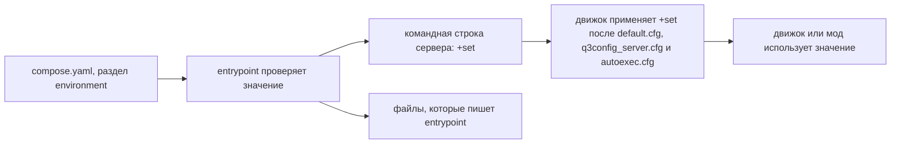

# ENV

Проверено запуском на `20261112-d608e3a-stock`, `20261112-c64186e-cpma`, `20261114-9e899840-osp`.

[ENV](../glossary.md#env) задаются в `environment:` сервиса в `compose.yaml`. [Entrypoint](../glossary.md#entrypoint) читает их один раз, при старте [контейнера](../glossary.md#контейнер).

## Как значение ENV попадает в игру

Для большинства ENV entrypoint проверяет значение и передаёт его аргументом командной строки сервера, например `+set server_gameplay "VQ3"`. Отдельный конфиг для этого он не создаёт. [Движок](../glossary.md#ioq3ded) задаёт эту переменную, а игра читает её, когда загружает карту. Позже движок может сохранить значение в [`q3config_server.cfg`](../glossary.md#q3config_servercfg), как описано ниже.



Так выглядит командная строка сервера из [примера CPMA](../examples/cpma/compose.yaml) с `GAMEPLAY: "vq3"`. Аргументы разнесены по строкам, «…» отмечает пропуски, адрес [peer-сервера](../glossary.md#peer-сервер), [alias](../glossary.md#alias) и порт заменены значениями примера:

```text
/app/ioq3ded.x86_64
  +set fs_basepath "/opt/q3-data"
  +set fs_homepath "/data/home"
  +set fs_game "cpma"
  …
  +set net_nativeUDP "1"
  …
  +set net_port "27960"
  …
  +set net_peer_server "wss://net.js-dos.com:444"
  +set net_server_name "room.q3ded.yourserver-cpma-ffa"
  +set sv_hostname "CPMA FFA"
  …
  +exec cpma.cfg
  +set server_gameplay "VQ3"
  +set mode_start "FFA"
  +set g_gametype "0"
  +set map_cfgdir "cfg-maps"
  +set map_rotate "1"
  +set sv_maxclients "12"
  +map pro-q3dm6
```

Проверено запуском примеров [stock](../glossary.md#stock), [CPMA](../glossary.md#cpma) и [OSP](../glossary.md#osp): командную строку показывает `/proc/<pid>/cmdline` процесса `ioq3ded.x86_64` в контейнере. Кавычки вокруг значений ставит entrypoint, в [`getstatus`](../glossary.md#getstatus) их нет. Значение `vq3` из ENV entrypoint передаёт заглавными буквами: `VQ3`. Посмотреть командную строку своего сервера можно так:

```sh
docker compose exec q3ded sh -c 'for d in /proc/[0-9]*; do [ "$(cat $d/comm 2>/dev/null)" = ioq3ded.x86_64 ] && tr "\000" "\n" < $d/cmdline; done'
```

Первые две строки вывода, `/app` и `ioq3ded.x86_64`, это путь к программе `/app/ioq3ded.x86_64`: движок при старте отделяет в нём каталог от имени файла (по коду ioq3, `Sys_Dirname` в `code/sys/sys_unix.c`).

Движок применяет все `+set` после `default.cfg`, `q3config_server.cfg` и [`autoexec.cfg`](../glossary.md#autoexeccfg), поэтому строка с той же переменной в этих файлах проигрывает. Остальные аргументы, `+exec` и `+map`, он выполняет после всех `+set`, где бы они ни стояли: [`cpma.cfg`](../glossary.md#конфиг-мода) выполняется уже после `+set server_gameplay`, хотя в строке стоит раньше. Так написано в коде ioq3 (`code/qcommon/common.c`, функции `Com_StartupVariable` и `Com_AddStartupCommands`). Игра печатает переменные, с которыми загрузила карту, в строке лога [`InitGame:`](../glossary.md#initgame), например `\server_gameplay\VQ3\` у CPMA и `\timelimit\15\fraglimit\30\` у stock. Кто кого перекрывает целиком, показано в [layers.md](layers.md#кто-кого-перекрывает).

Многие из этих значений движок сохраняет в `/data/home/<мод>/q3config_server.cfg`. Когда эта копия действует, а когда нет, описано в [layers.md](layers.md#q3config_servercfg). Проверено запуском на CPMA: в копии `server_gameplay` заменили на `CPM`, `sv_hostname` и `sv_maxclients` на другие значения, после [`docker compose restart`](../glossary.md#рестарт-контейнера) в логе было `execing q3config_server.cfg`, а `getstatus` показал прежние `VQ3`, `CPMA FFA` и `12`. Движок переписал копию значениями из ENV.

Часть ENV становится не аргументом `+set`, а файлом или полем [`status.json`](../glossary.md#statusjson), а часть entrypoint только проверяет:

| Что получает сервер | ENV |
|---|---|
| файл, который entrypoint пишет при каждом старте | `Q3_MAPLIST`: у stock при двух картах и больше `/data/home/demoq3/rotation.cfg` и аргументы `+exec rotation.cfg +vstr rotate1`; у CPMA список карт режима, например `/data/home/cpma/cfg-maps/ffamaps.txt`, а в duel со значениями `FRAGLIMIT` и `TIMELIMIT` в колонках |
| файл, который entrypoint пишет при `RUN_ROOM_AGENT=1` | `NET_SERVER_NAME`, `CLOUD_BASE_URL`: entrypoint записывает alias из `NET_SERVER_NAME` и, если задан `CLOUD_BASE_URL`, адрес из него в `/data/run/dedicated_room_agent.runtime.toml`, этот файл читает [агент комнаты](../glossary.md#агент-комнаты) |
| ENV `VPS_DEDICATED_*` в окружении процесса сервера: сервер сам пишет их в `/data/run/status.json`, откуда они попадают в [лобби](../glossary.md#лобби), см. [таблицу ниже](#простые-env) | `HOSTNAME` (поле `name`), `VPS_DEDICATED_IMAGE` (`image`), `MODE` (`gametype`), у CPMA [`PRESET`](../glossary.md#preset) (`preset`) |
| только entrypoint, аргументом `+set` не становится | `RUN_ROOM_AGENT`, `RTC_WAIT_SECS`, `RELEASE_PROFILE`, `Q3_APP_DIR`, `Q3_RUN_DIR` |

Файлы и `status.json` проверены запуском примеров. То, что сервер берёт эти значения из своего окружения, написано в коде ioq3 (`code/server/sv_main.c`, функция `SV_WriteStatusFile`).

## Когда применяется изменённый ENV

| Событие | Значение ENV |
|---|---|
| [`map_restart`](../glossary.md#map_restart) | прежнее |
| новая карта (`map`, [ротация](../glossary.md#ротация-карт)) | прежнее |
| `docker compose restart` | прежнее: **правка ENV не применяется** |
| `docker compose up -d` после правки `compose.yaml` ([пересоздание](../glossary.md#пересоздание-контейнера), [тома](../glossary.md#том) прежние) | новое |
| запуск с новыми томами | новое |

Правку ENV применяет `docker compose up -d --force-recreate q3ded`, это та же команда, что и для файлов. Обычный `docker compose up -d` правку ENV тоже применяет: Compose видит изменение и пересоздаёт контейнер. Без изменений в `compose.yaml` и `env_file` команда `up -d` ничего не делает. Тома остаются в обоих случаях. Проверено запуском на stock (`HOSTNAME`, `TIMELIMIT`), CPMA и OSP (`HOSTNAME`): после `docker compose restart` остаётся прежнее имя, после пересоздания появляется новое. Смену `MODE` на прежних томах применили `up -d` (CPMA) и `up -d --force-recreate` (OSP); через `map_restart` и смену карты ENV не меняется.

«Не задан» значит, что строки нет в `environment:`, а «пусто» значит `ИМЯ: ""`. Для большинства ENV это одно и то же, а где это не так, сказано в строке.

## Простые ENV

| ENV | Моды | Не задан / пусто | Допустимо | Что получает сервер | Проверка |
|---|---|---|---|---|---|
| `MODE` | все | stock `ffa`, CPMA `duel`, OSP `duel` | stock `ffa duel tdm ctf`; CPMA `duel ffa tdm ctf ca ftag ctfs`; OSP `duel ffa tdm ctf ca ftag` | stock: `+set g_gametype`; CPMA: `+set mode_start`, `g_gametype`, `map_cfgdir`; OSP: `+set mode_start`, `g_gametype`, `server_availmodes`. Без `MAP` и списка карт ещё `+map` с картой по умолчанию режима; номер режима для [лобби](../glossary.md#лобби) идёт в `status.json`. Значения аргументов для каждого `MODE` приведены в таблицах [«Игра и правила»](pinned.md#игра-и-правила) и [«CPMA и OSP: режим»](pinned.md#cpma-и-osp-режим) | лог `Starting ioq3ded: mode=…`; `getstatus`: `g_gametype` |
| `MAP` | все | карта по умолчанию режима | имя `[A-Za-z0-9_-]{1,64}` из [`/app/maps.txt`](../glossary.md#каталог-карт); у stock ещё карта из своего [PK3](../glossary.md#pk3) | `+map <карта>`; при `maplist.txt` допустимо только пусто или первая строка | лог `Server: <карта>`; `getstatus`: `mapname` |
| `Q3_MAPLIST` | stock, CPMA | `/data/maplist.txt`; если файла нет, ротации нет | путь к файлу | файл: у stock при двух картах и больше `rotation.cfg` и `+exec rotation.cfg +vstr rotate1`, у CPMA список карт режима и `+set map_rotate` (`1` при двух картах и больше), см. [выше](#как-значение-env-попадает-в-игру); OSP не читает | лог `Server: <первая карта списка>`; у CPMA ещё `Loading maplist from …` |
| `Q3_CUSTOM_DIR` | stock | `/data/custom/demoq3` | читаемый каталог | `+set fs_custompath <значение>` | [консоль](../glossary.md#консоль-сервера) или [rcon](../glossary.md#rcon): `fs_custompath` |
| `DOWNLOAD_URL` | stock | нет | `https://host[:port]/путь` без логина, `?`, `#`, `..` | `+set sv_dlURL <значение>`, у stock передаётся и пустым: адрес, откуда клиент берёт PK3 по HTTPS вместо [UDP](../glossary.md#udp), см. [stock](../stock/README.md#свои-карты). CPMA и OSP: должно быть пусто | консоль или rcon: `sv_dlURL` |
| `DOWNLOAD_RATE` | stock | 100 | 1–100000 КиБ/с | `+set sv_dlRate <значение>`; CPMA и OSP: должно быть пусто | `getstatus`: `sv_dlRate` |
| `NATIVE_UDP` | все | не задан: 0; **пусто: [отказ](../glossary.md#отказ-при-старте)** | `0`, `1` | `+set net_nativeUDP <значение>`; `1` нужен [обычным клиентам](../glossary.md#обычный-клиент) и rcon | лог `Native UDP families: 1`, `Opening IP socket: …`; `getstatus` отвечает |
| `NATIVE_BIND` | все | не задан: `0.0.0.0`; пусто: отказ | IPv4-адрес | `+set net_ip <значение>` | лог `Opening IP socket: <адрес>:<PORT>` |
| `PORT` | все | 27960 | 1–65535 | `+set net_port <значение>`, `+set net_port6 <значение>`; при [сети bridge](network.md#соединения) то же число в `ports:` | лог `Opening IP socket: <адрес>:<PORT>`; `getstatus` на этот порт |
| `NATIVE_IPV6` | все | не задан: 0; пусто: отказ | `0`, `1`; `1` требует `NATIVE_UDP=1` | `+set net_enabled 1` при `0`, `+set net_enabled 3` при `1` | консоль или rcon: `net_enabled` (`3`) |
| `NATIVE_BIND6` | все | не задан: `::`; пусто: отказ | IPv6-адрес, можно с `%scope`; адрес IPv4-mapped, то есть IPv4-адрес в записи IPv6, не допускается | `+set net_ip6 <значение>`; проверяется, даже если IPv6 выключен | консоль или rcon: `net_ip6` |
| `PUBLISH_Q3_MASTER` | все | не задан: 0; пусто: отказ | `0`, `1`; `1` требует `NATIVE_UDP=1` | `+set sv_masterPublish <значение>` | консоль или rcon: `sv_masterPublish`; сервер в ответе мастера, см. [сеть](network.md#мастер-серверы) |
| `Q3_MASTERS` | все | не задан: `directory.ioquake3.org:27950`; пусто: без мастеров | до пяти `host[:port]` через пробел | `+set sv_master1` … `+set sv_master5`, лишние пустые | консоль или rcon: `sv_master1` … `sv_master5` |
| `RTC_WAIT_SECS` | все | 30 | 0–30 | только проверка entrypoint: сколько ждать [`rtc.json`](../glossary.md#rtcjson) от агента комнаты | если `rtc.json` за это время не появился, отказ `rtc.json not ready after <N>s` |
| `RELEASE_PROFILE` | все | | только профиль [образа](../glossary.md#образ) | только проверка entrypoint | другое значение: отказ `RELEASE_PROFILE conflicts with package` |
| `Q3_APP_DIR`, `Q3_DATA_DIR`, `Q3_RUN_DIR`, `Q3_HOME_DIR` | все | `/app`, `/opt/q3-data`, `/data/run`, `/data/home` | | `Q3_DATA_DIR`: `+set fs_basepath <значение>`, `Q3_HOME_DIR`: `+set fs_homepath <значение>`, `Q3_APP_DIR` задаёт каталог программы сервера, агента и служебных файлов образа, `Q3_RUN_DIR` задаёт рабочий каталог запуска, где лежат `status.json`, `rtc.json` и настройки агента. Все четыре для локального запуска вне образа; в контейнере не задавайте | |
| `LD_LIBRARY_PATH` | все | задан в образе: `/app` | | entrypoint добавляет `/app` в начало значения и передаёт переменную запускаемым процессам. Она задаёт каталоги, где ищутся библиотеки. Аргумент `+set` и конфиг из неё не создаются | |

Значения по умолчанию, допустимые значения и разница между «не задан» и «пусто» в этой таблице даны по коду entrypoint. Аргументы в колонке «Что получает сервер» сняты с командной строки трёх примеров (проверено запуском на stock, CPMA и OSP), а аргументы для значений, которых в примерах нет, даны по коду entrypoint. Запуском проверены отказы, отмеченные ✓ в [таблице отказов](../troubleshooting.md#отказы-при-старте), и то, что сказано на страницах [сети](network.md) и [ротации](../recipes/rotation.md). Кроме того, на stock проверено запуском:

- если `Q3_MASTERS` не задан, `sv_master1` равен `directory.ioquake3.org:27950`, остальные пусты; если `Q3_MASTERS` пуст, пусты все пять;
- шесть адресов в `Q3_MASTERS` дают отказ, `PUBLISH_Q3_MASTER=1` с пустым `Q3_MASTERS` тоже даёт отказ;
- пустые `NATIVE_UDP`, `NATIVE_BIND`, `PUBLISH_Q3_MASTER` дают отказ;
- `RTC_WAIT_SECS=31` даёт отказ `RTC_WAIT_SECS must be <= 30`;
- с `DOWNLOAD_URL` своя карта загружается по HTTPS.

ENV из таблицы ниже entrypoint перезаписывает сам и значение оператора отбрасывает. Проверено запуском на stock с переменными `VPS_DEDICATED_Q3_VERSION=99`, `VPS_DEDICATED_NAME`, `VPS_DEDICATED_GAMETYPE=7` и `VPS_DEDICATED_PRESET` в ENV. В `status.json` и в данных [комнаты](../glossary.md#комната), которые получает лобби, были `q3Version` 37, `gametype` 2 и имя, равное alias; поля preset у stock нет. У OSP значение `q3Version` 38 видно в карточке лобби.

| ENV | Чем перезаписывается |
|---|---|
| `VPS_DEDICATED_Q3_VERSION` | `browser_version` из `/app/runtime-manifest.txt`: stock 37, CPMA 37, OSP 38; лобби получает её как `q3Version` |
| `VPS_DEDICATED_NAME` | `HOSTNAME` после подстановки alias |
| `VPS_DEDICATED_GAMETYPE` | номер режима для лобби по `MODE` |
| `VPS_DEDICATED_PRESET` | CPMA: `PRESET`; stock и OSP: сбрасывается |

Все сочетания `MODE`, `PRESET`, `MAXCLIENTS`, лимитов и карт описаны в разделах [stock](../stock/README.md#сочетания), [CPMA](../cpma/README.md#сочетания), [OSP](../osp/README.md#сочетания).

## Карточки

Диапазоны, значения по умолчанию и поведение при «не задан» и «пусто» в карточках ниже даны по коду entrypoint, если в строке не сказано, что это проверено запуском.

### HOSTNAME

| | |
|---|---|
| [Моды](../glossary.md#мод) | все |
| Что получает сервер | `+set sv_hostname <значение>`; то же значение entrypoint передаёт серверу в ENV `VPS_DEDICATED_NAME`, а сервер пишет его в `status.json` (`name`), откуда берётся имя комнаты в лобби |
| Значения | любой текст до 509 байт, без `"` и переводов строки |
| Не задан, пуст или равен имени самого контейнера | вместо него берётся alias `NET_SERVER_NAME` |
| Как изменить | правка ENV, затем `docker compose up -d --force-recreate q3ded` |
| Когда действует правка | как у любого ENV: значение держится после `map_restart`, смены карты и `docker compose restart`, новое значение применяется при пересоздании, см. [таблицу](#когда-применяется-изменённый-env) |
| Проверка | `getstatus`: `sv_hostname`; карточка комнаты в лобби |

Docker сам кладёт в ENV `HOSTNAME` имя хоста контейнера. Entrypoint считает такое значение незаданным и показывает alias.

Имя в лобби dos.zone берётся из `HOSTNAME` при старте контейнера. `sv_hostname`, заданный через rcon, меняет только ответ `getstatus` и списки серверов обычных клиентов. Карточка в лобби и `status.json` остаются со старым именем и после смены карты. Чтобы переименовать карточку, смените `HOSTNAME` и пересоздайте контейнер.

### VPS_DEDICATED_IMAGE

| | |
|---|---|
| Моды | все |
| Что получает сервер | ENV в окружении процесса: сервер сам пишет значение в `status.json` (`image`), откуда оно попадает в лобби |
| Не задан или пуст | картинка стартовой карты из 4-й колонки `/app/maps.txt` |
| Задан | URL как есть |
| Как изменить | правка ENV, затем `docker compose up -d --force-recreate q3ded` |
| Когда действует правка | как у любого ENV: значение держится после `map_restart`, смены карты и `docker compose restart`, новое значение применяется при пересоздании, см. [таблицу](#когда-применяется-изменённый-env). При смене карты в `status.json` и в данных комнаты, которые получает лобби, остаётся значение со старта |
| Проверка | `docker compose exec q3ded cat /data/run/status.json`: поле `image` |

Лобби dos.zone для карт из каталога образа этой картинки не показывает. Карточка берёт картинку карты из каталога самого лобби и меняет её вместе с картой. Своя картинка дошла до `status.json` и до данных комнаты, которые получает лобби, но в карточке её не было. Как карточка ведёт себя на своей карте stock, которой нет в каталоге лобби, не проверялось.

### NET_SERVER_NAME

| | |
|---|---|
| Моды | все |
| Что получает сервер | `+set net_server_name <значение>`; агент комнаты получает alias в `/data/run/dedicated_room_agent.runtime.toml` |
| Значения | `room.q3ded.<суффикс>`: латиница, цифры, `. _ -`, всего до 117 символов |
| Не задан или пуст | отказ `NET_SERVER_NAME is required: set a unique room.q3ded.<suffix> alias` |
| Как изменить | правка ENV, затем `docker compose up -d --force-recreate q3ded` |
| Когда действует правка | как у любого ENV: значение держится после `map_restart`, смены карты и `docker compose restart`, новое значение применяется при пересоздании, см. [таблицу](#когда-применяется-изменённый-env) |
| Проверка | в логе `Alias "room.q3ded.<суффикс>" registration confirmed`; карточка комнаты в лобби |

Alias задаёт адрес комнаты в лобби. Берите свой суффикс, не копируйте чужой и не повторяйте его на двух серверах.

Второму серверу на том же хосте мало своего alias и порта: в его `compose.yaml` нужно своё `name:`. С тем же `name:` его `docker compose up -d` пересоздаст первый сервер и заберёт его тома. Проверено запуском двух копий примера stock. С одинаковым `name:` после `up -d` второй копии остался один контейнер, с портом и файлами второй копии и томами первой, а порт первой копии больше не слушался. С разными `name:` работают оба сервера, у каждого свои тома и своя комната. Обновляя существующий сервер, `name:` не меняйте.

Суффикс, который заканчивается на `p`, прячет кнопку Join. Это проверено запуском на тестовой копии лобби, где комнаты показаны карточками: карточка такой комнаты видна, но вместо Join на ней неактивная кнопка «Private room». В компактном списке лобби такие комнаты, по коду сайта, не показываются вовсе. На dos.zone запуском это не проверялось. Закрытой комната при этом не становится: любой, у кого есть ссылка `?join=<alias>&lobby=q3`, входит в неё (проверено запуском). Если кнопка Join нужна, не заканчивайте суффикс на `p`.

### NET_PEER_SERVER

| | |
|---|---|
| Моды | все |
| Что получает сервер | `+set net_peer_server <значение>` |
| Значения | `ws://host[:port]` или `wss://host[:port]` |
| Не задан | stock, OSP: `wss://net.js-dos.com:444`; CPMA: отказ `CPMA requires the approved native NET_PEER_SERVER` |
| Пуст | stock, OSP: принимается и передаётся серверу как пустой `net_peer_server` (по коду entrypoint; что делает сервер с пустым адресом, запуском не проверялось); CPMA: тот же отказ |
| Как изменить | правка ENV, затем `docker compose up -d --force-recreate q3ded`; пересобирать образ не нужно |
| Когда действует правка | как у любого ENV: значение держится после `map_restart`, смены карты и `docker compose restart`, новое значение применяется при пересоздании, см. [таблицу](#когда-применяется-изменённый-env) |
| Проверка | `registration confirmed` в логе |

Для dos.zone значение такое: `NET_PEER_SERVER: wss://net.js-dos.com:444`. Для CPMA его нужно задать явно.

### CLOUD_BASE_URL

| | |
|---|---|
| Моды | все, только при `RUN_ROOM_AGENT=1` |
| Что получает сервер | ничего; агент комнаты получает `base_url` в `/data/run/dedicated_room_agent.runtime.toml`: адрес, по которому он публикует комнату |
| Не задан или пуст | агент берёт адрес dos.zone из своего шаблона, `https://cloud.js-dos.com`, и комната появляется в лобби dos.zone |
| Задан | `http(s)://host[:port]` без пути |
| Как изменить | правка ENV, затем `docker compose up -d --force-recreate q3ded` |
| Когда действует правка | как у любого ENV: значение держится после `map_restart`, смены карты и `docker compose restart`, новое значение применяется при пересоздании, см. [таблицу](#когда-применяется-изменённый-env) |
| Проверка | для dos.zone карточка комнаты в [лобби dos.zone](https://dos.zone/mp/index.html?lobby=q3); при другом адресе проверяйте лобби, для которого он задан |

Для dos.zone не задавайте его вовсе. Как перейти с другого лобби на dos.zone, описано в [рецепте](../recipes/stand-to-dozone.md).

### RUN_ROOM_AGENT

| | |
|---|---|
| Моды | все |
| Что получает сервер | только entrypoint: решает, запускать ли агент комнаты |
| Не задан, пуст или `1` | при каждом старте удаляет `/data/run/status.json` и `/data/run/rtc.json` (оба появляются заново), пишет `dedicated_room_agent.runtime.toml`, запускает агент комнаты и ждёт `rtc.json` до `RTC_WAIT_SECS` секунд |
| `0` | агент не запускается; нужен готовый непустой `/data/run/rtc.json`, иначе отказ `RUN_ROOM_AGENT=0 requires a non-empty rtc.json in /data/run`. С файлом, оставшимся в томе от прошлого запуска, сервер стартует (`registration confirmed`), `rtc.json` сохраняется и после рестарта и пересоздания, `status.json` пишется заново. Комнаты в лобби нет |
| Как изменить | правка ENV, затем `docker compose up -d --force-recreate q3ded` |
| Когда действует правка | как у любого ENV: значение держится после `map_restart`, смены карты и `docker compose restart`, новое значение применяется при пересоздании, см. [таблицу](#когда-применяется-изменённый-env) |
| Проверка | в логе `rtc.json appeared`, затем `Starting ioq3ded: …` |

Оставьте `1`, если не запускаете агент комнаты отдельно.

### GAMEPLAY

| | |
|---|---|
| Моды | CPMA; у stock непустое значение даёт отказ `GAMEPLAY is CPMA-only`; OSP его не читает |
| Что получает сервер | `+set server_gameplay VQ3` или `+set server_gameplay CPM`: entrypoint пишет значение заглавными буквами |
| Значения | `cpm` (по умолчанию), `vq3`; не задан = пусто = `cpm` |
| Как изменить | правка ENV, затем `docker compose up -d --force-recreate q3ded` (не `restart`) |
| Когда действует правка | как у любого ENV: значение держится после `map_restart`, смены карты и `docker compose restart`, новое значение применяется при пересоздании. `server_gameplay VQ3` держится после `map_restart` и `map` |
| Проверка | лог: `Starting ioq3ded: … gameplay=VQ3` (эту строку печатает entrypoint); `getstatus`: `server_gameplay`, по умолчанию `CPM`, с `vq3` значение `VQ3` |

Путь значения целиком: `GAMEPLAY: "vq3"` в `compose.yaml` → entrypoint проверяет его и передаёт серверу `+set server_gameplay "VQ3"` → движок применяет его после `autoexec.cfg` и до `+exec cpma.cfg` → CPMA загружает карту с этим значением. В игре его видно в строке лога `InitGame: …\server_gameplay\VQ3\…`, в `getstatus` (`server_gameplay`) и в `/data/run/status.json` (`"gameplay": "VQ3"`). Проверено запуском примера CPMA с `GAMEPLAY: "vq3"`, командная строка показана [в начале страницы](#как-значение-env-попадает-в-игру).

Строка `set server_gameplay …` в `autoexec.cfg` проигрывает этому ENV. Пошагово это описано в рецепте [физика VQ3 в CPMA](../recipes/cpma-vq3.md).

### PRESET

| | |
|---|---|
| Моды | CPMA; у stock и OSP допустим только `classic` |
| Что получает сервер | `+set mode_start DZ…`: режим из `/opt/q3-data/cpma/modes/<имя>.cfg`; при `classic` в [`mode_start`](../glossary.md#режим-мода) имя режима, в примере CPMA `FFA`. Выбор попадает и в `status.json` (`preset`) |
| Значения | `classic` (по умолчанию); `instagib` при `MODE` ffa, tdm, ctf, ftag; `rocket-only`, `bfg-only`, `gauntlet-only` при `MODE=ffa` |
| Как изменить | правка ENV, затем `docker compose up -d --force-recreate q3ded` |
| Когда действует правка | как у любого ENV: значение держится после `map_restart`, смены карты и `docker compose restart`, новое значение применяется при пересоздании, см. [таблицу](#когда-применяется-изменённый-env) |
| Проверка | `getstatus`: `mode_current`; с `classic` видно имя режима, например `FFA`, `TDM`. С `MODE=ffa PRESET=rocket-only` в нём `DZRFFA`, в логе `Custom Mode: DZRFFA` (с цветовыми кодами). Остальные сочетания тоже проверены запуском: `instagib` с `MODE` ffa, tdm, ctf, ftag даёт `DZIFFA`, `DZITDM`, `DZICTF`, `DZIFT`, `bfg-only` даёт `DZBFFA`, `gauntlet-only` даёт `DZGFFA` |

Другое сочетание даёт отказ `PRESET must be classic, instagib (MODE=ffa|tdm|ctf|ftag) or rocket-only|bfg-only|gauntlet-only (MODE=ffa)`. Таблица сочетаний есть в разделе [CPMA](../cpma/README.md#сочетания).

### MAXCLIENTS

| | |
|---|---|
| Моды | все |
| Что получает сервер | stock, CPMA: `+set sv_maxclients <значение>`; у OSP только проверка entrypoint, в командной строке OSP `sv_maxclients` нет (проверено запуском), а 14 задаёт `osp.cfg` |
| Значения | stock 2–26, по умолчанию 8, duel 2; CPMA 2–26, по умолчанию 20, duel только 20; OSP только 14 |
| Как изменить | правка ENV, затем `docker compose up -d --force-recreate q3ded` |
| Когда действует правка | как у любого ENV: значение держится после `map_restart`, смены карты и `docker compose restart`, новое значение применяется при пересоздании, см. [таблицу](#когда-применяется-изменённый-env) |
| Проверка | `getstatus`: `sv_maxclients`; в лобби `0/<N>` |

### TIMELIMIT, FRAGLIMIT, CAPTURELIMIT

| | |
|---|---|
| Моды | stock: все режимы; CPMA: только duel; OSP: должны быть пусты |
| Что получает сервер | stock: `+set timelimit <значение>`, `+set fraglimit <значение>`; `+set capturelimit <значение>` только при `MODE=ctf`. CPMA duel: сервер получает `+set timelimit 3` и `+set fraglimit 3`, а ещё entrypoint записывает `FRAGLIMIT` и `TIMELIMIT` в четвёртую и пятую колонки `/data/home/cpma/cfg-pilot/1v1maps.txt`, который читает CPMA (порядок колонок по коду entrypoint). OSP: только проверка entrypoint |
| Значения stock | `TIMELIMIT` 0–35791 минут, по умолчанию 15; `FRAGLIMIT` 0–2147483647, по умолчанию 30; `CAPTURELIMIT` 0–2147483647, по умолчанию 8. При других режимах, кроме `ctf`, `CAPTURELIMIT` проверяется, но на сервер не передаётся |
| CPMA | duel: `TIMELIMIT` и `FRAGLIMIT` только `3`; `CAPTURELIMIT` 0–2147483647, по умолчанию 8, проверяется, но в игру не передаётся. Остальные режимы берут лимиты из режима CPMA, и любой из трёх ENV в них даёт отказ |
| OSP | лимиты задаёт режим OSP; любой из трёх ENV даёт отказ `OSP uses native limits` |
| Как изменить | правка ENV, затем `docker compose up -d --force-recreate q3ded` |
| Когда действует правка | stock: как у любого ENV, значение держится после `map_restart`, смены карты и `docker compose restart`, новое значение применяется при пересоздании |
| Проверка | stock: `getstatus`: `timelimit`, `fraglimit`, `capturelimit`. У CPMA эти поля лимитов матча не показывают; у OSP в них значения режима |

Проверено запуском на stock: `TIMELIMIT=35791`, `FRAGLIMIT=2147483647`, `CAPTURELIMIT=2147483647` (`MODE=ctf`) приняты и видны в `getstatus`; `TIMELIMIT=35792` даёт отказ `TIMELIMIT must be <= 35791`, `FRAGLIMIT=2147483648` даёт `FRAGLIMIT must be <= 2147483647`, 11 цифр дают `… must be a non-negative integer`; по умолчанию 15, 30, 8; `CAPTURELIMIT=17` при `ffa` на сервер не передаётся, при `ctf` передаётся. CPMA duel: `CAPTURELIMIT=17` принят, в аргументах сервера и в списке карт (`cpm1a 0 99 3 3`) его нет; `CAPTURELIMIT=abc` даёт отказ. Отказы CPMA и OSP на лимиты получены запуском.

`capturelimit`, заданный при `ctf`, сохраняется в `/data/home/demoq3/q3config_server.cfg`; после перехода на другой режим `getstatus` показывает это значение, пока том `home` тот же. На `ctf` entrypoint всегда передаёт своё значение.

rcon `timelimit` на stock переживает смену карты и теряется при рестарте: entrypoint снова задаёт ENV.
