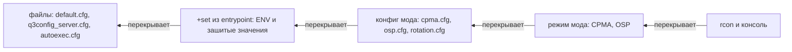

# Порядок настроек

Проверено запуском на `20261112-d608e3a-stock` и `20261112-c64186e-cpma`, а там, где это сказано, и на [OSP](../glossary.md#osp) `20261114-9e899840-osp`.

## Кто кого перекрывает



Слои применяются слева направо, и каждый следующий перекрывает предыдущий.

| Слой | Когда выполняется | Что важно |
|---|---|---|
| `default.cfg` → [`q3config_server.cfg`](../glossary.md#q3config_servercfg) → [`autoexec.cfg`](../glossary.md#autoexeccfg) | при старте, до командной строки | порядок виден в логе: `execing default.cfg`, `execing q3config_server.cfg`, `execing autoexec.cfg` |
| `+set` | после файлов | [ENV](env.md) и [зашитые значения](pinned.md); всё, что задано здесь, побеждает `autoexec.cfg` |
| `+exec` | после всех `+set` | [`cpma.cfg`](../glossary.md#конфиг-мода) у [CPMA](../glossary.md#cpma), `osp.cfg` у OSP, `rotation.cfg` у [stock](../glossary.md#stock) с несколькими картами |
| режим мода | при старте сервера: у CPMA в том же первом `InitGame`, у OSP примерно через 1,8 с после первого `InitGame` (строка `Default mode "<режим>" enabled.`, затем второй `InitGame`) | CPMA и OSP задают переменные своего режима. У OSP смена карты режим заново не загружает. У CPMA после [rcon](../glossary.md#rcon) `map` параметры режима ([`warmup`](../glossary.md#разминка)) возвращаются, а значения переменных, заданные через rcon (`team_allcaptain`), остаются |
| rcon, [консоль](../glossary.md#консоль-сервера) | когда вы ввели команду | действует до события, которое его сбрасывает, см. [жизненный цикл](#жизненный-цикл-настройки) |

Исключения из схемы:

| Случай | Что происходит |
|---|---|
| rcon поверх зашитого `+set` | действует до [рестарта контейнера](../glossary.md#рестарт-контейнера), после рестарта [entrypoint](../glossary.md#entrypoint) снова задаёт своё значение |
| CPMA без игроков 10 минут | `Idle for 10 minutes: resetting back to defaults`: режим и первая карта списка возвращаются |
| OSP, переменные режима | значение из `autoexec.cfg` перекрывается при загрузке режима |

## Какой файл читается

| Переменная | Значение | Что это |
|---|---|---|
| `fs_basepath` | `/opt/q3-data` | файлы [образа](../glossary.md#образ) и файлы, которые вы [смонтировали](../glossary.md#смонтированный-файл) с хоста |
| `fs_homepath` | `/data/home` | [том](../glossary.md#том) `home`, в него пишет [движок](../glossary.md#ioq3ded) |
| [`fs_game`](../glossary.md#каталог-игры) | `demoq3` (stock), `cpma`, `osp` | каталог [мода](../glossary.md#мод) внутри обоих каталогов |

Движок берёт первый найденный файл. Для обычного `.cfg` в штатных каталогах сервера проверен порядок из таблицы ниже, а фактическую цепочку на вашем сервере показывает rcon `path`:

| Порядок | Где ищет |
|---|---|
| каталоги | `/data/home/<мод>`, затем `/opt/q3-data/<мод>`; у stock и OSP дальше `/data/home/baseq3` и `/opt/q3-data/baseq3` |
| внутри одного каталога | сначала отдельный файл (не внутри PK3), затем PK3 этого каталога в обратном порядке имён: `zz-b.pk3` раньше `zz-a.pk3` |
| исключение | `autoexec.cfg` и `q3config_server.cfg` движок из PK3 не читает, только отдельным файлом; про `autoexec.cfg` подробно ниже, про `q3config_server.cfg` так написано в коде ioq3 |

Поэтому PK3 в `/data/home/<мод>` перекрывает отдельный файл в `/opt/q3-data/<мод>`. Проверено запуском на stock с `.cfg` через `exec`. Когда отдельный файл и PK3 лежали в `/data/home`, выполнился отдельный файл. Когда отдельный файл лежал в `/opt/q3-data/demoq3`, а PK3 в `/data/home`, выполнился файл из PK3. Из двух PK3 в `/data/home` выполнился `zz-b.pk3`. Как положить и выполнить свой `.cfg`, описано в рецепте [«Свои конфиги для опытов»](../recipes/own-configs.md).

Из двух отдельных `autoexec.cfg` по этому же правилу выполняется один:

| Где лежит `autoexec.cfg` | Что выполняется |
|---|---|
| только `/opt/q3-data/<мод>/` (смонтирован с хоста, как в примере) | этот файл |
| и там, и в `/data/home/<мод>/` | только копия в `/data/home`; смонтированный файл не выполняется совсем |

Проверено запуском на stock, CPMA и OSP файлами с разными метками: при двух файлах выполнилась только копия из `/data/home`, а после её удаления и `docker compose restart` выполнился смонтированный файл. У CPMA и OSP `autoexec.cfg` в `/data/home` [отказа](../glossary.md#отказ-при-старте) `Conflicting CPMA saved content` не вызывает.

Копия в `/data/home` появляется, только если её туда положили. Удалить её можно так:

```sh
mod=cpma    # ваш каталог игры: demoq3, cpma или osp
docker compose run --rm --no-deps --entrypoint rm q3ded "/data/home/$mod/autoexec.cfg"
docker compose restart q3ded
```

`autoexec.cfg` внутри PK3 не выполняется никогда: движок читает этот файл только отдельным файлом и при поиске пропускает PK3. Выполняется отдельный файл `autoexec.cfg` по правилу выше, где бы ни лежал PK3. Если `autoexec.cfg` есть только внутри PK3, в логе будет `couldn't exec autoexec.cfg`. Так написано в коде ioq3, а запуском это проверено на stock с PK3 в `/data/home/demoq3` и в `/opt/q3-data/demoq3`.

Конфиги режимов CPMA лежат в `/opt/q3-data/cpma/` отдельными файлами, конфиги OSP лежат внутри `zz-osp-*.pk3`. Подменить их нельзя: CPMA и OSP останавливают запуск, если находят в `/data/home` файл, который мог бы скрыть файл образа, или любой изменённый файл в `/opt/q3-data`, см. [container.md](container.md#каталоги). Свои PK3 принимает только stock, и для них предусмотрен каталог `/data/custom/demoq3`, см. [свои карты](../recipes/stock-custom-maps.md). PK3, положенный в `/data/home/demoq3` или смонтированный в `/opt/q3-data/demoq3`, stock тоже загружает без отказа: он появляется в `path` и `sv_pakNames`. Войдёт ли игрок, у которого этого PK3 нет, не проверялось.

## q3config_server.cfg

Этот файл пишет сам движок, вручную его не создают. В нём хранятся [archive-переменные](../glossary.md#archive-переменная).

| | |
|---|---|
| Где | `/data/home/<мод>/q3config_server.cfg` |
| Когда пишется | появляется на первом кадре после `autoexec.cfg`; переписывается при `InitGame`, когда игра регистрирует свои archive-переменные, а у OSP ещё раз примерно через 2 секунды. Дальше файл переписывается только после изменения archive-переменной: своя переменная, заданная rcon `set`, файл не трогает. Проверено запуском на stock, CPMA и OSP |
| Когда читается | при следующем старте, до `autoexec.cfg` |
| Что в нём | все archive-переменные, включая зашитые (`sv_hostname`, `g_allowVote`, `timelimit`); зашитые всё равно перекрываются `+set` |
| Чего в нём нет | `rconPassword`: это не archive-переменная |
| Первый старт на новых томах | строка `couldn't exec q3config_server.cfg` в логе нормальна |

Отсюда следует, что archive-значение, заданное через rcon, переживает рестарт и [пересоздание контейнера](../glossary.md#пересоздание-контейнера), только если при старте его никто не задаёт заново. `autoexec.cfg` выполняется после `q3config_server.cfg`, а `+set` и конфиг мода ещё позже, и они побеждают: после rcon `match_readypercent 33` на CPMA и рестарта значение снова `77` из `autoexec.cfg`. Своя переменная, заданная через rcon `seta`, переживает рестарт и пересоздание и теряется только вместе с томом `home` (`down -v`). Своя переменная, заданная через rcon `set`, теряется уже при рестарте. OSP на втором старте тоже выполняет файл, записанный на первом.

В файл попадают и многие значения из [ENV](env.md). После старта примеров stock, CPMA и OSP там были `sv_hostname`, `sv_maxclients`, `sv_dlURL`, `sv_dlRate`, `net_peer_server`, `net_server_name` на всех трёх модах, `timelimit` и `fraglimit` у stock, `server_gameplay` у CPMA. Поэтому ручная правка файла меняет только переменные, которые entrypoint на этом старте не задаёт, например `capturelimit` у stock вне режима `ctf`, см. [карточку лимитов](env.md#timelimit-fraglimit-capturelimit). Правку `server_gameplay` на CPMA перекрыл `+set`, см. [опыт на CPMA](env.md#как-значение-env-попадает-в-игру).

## Жизненный цикл настройки

«Да» в таблицах значит, что значение сохраняется после события. Правку смонтированного файла читают и `restart`, и пересоздание, как бы редактор ни сохранил файл, см. [примечания](#примечания).

### stock

| Как задано | `map_restart` | новая карта (`map` или ротация) | `docker compose restart` | `up -d --force-recreate`, прежние тома | новые тома (`down -v`, `up -d`) |
|---|---|---|---|---|---|
| `autoexec.cfg`, смонтирован с хоста в `/opt/q3-data` | да | да | да; правка файла применяется | да; правка применяется | да: файл на хосте |
| `autoexec.cfg` в `/data/home` | да | да | да | да | **нет**: файл был в томе |
| rcon: новая переменная или переменная без флагов | да | да | **нет** | нет | нет |
| rcon: archive-переменная (`seta`, `g_warmup`) | да | да | **да**: из `q3config_server.cfg` | **да** | нет |
| rcon поверх зашитого `+set` (`g_allowVote`, `timelimit`, `g_doWarmup`) | да | да | **нет**: снова зашитое значение | нет | нет |
| ENV (`HOSTNAME`, `TIMELIMIT`) | да | да | да; **изменённый ENV не применяется** | изменённый ENV применяется | применяется |

### CPMA

| Как задано | `map_restart` | новая карта | `docker compose restart` | `up -d --force-recreate`, прежние тома | новые тома |
|---|---|---|---|---|---|
| `autoexec.cfg`, смонтирован с хоста в `/opt/q3-data` | да | да | да; правка файла применяется | да; правка применяется | да |
| `autoexec.cfg` в `/data/home` | да | да | да | да | **нет**: файл был в томе |
| rcon: новая переменная или переменная без флагов | да | да | **нет** | нет | нет |
| rcon: archive-переменная, которую больше никто не задаёт (`seta`) | да | да | **да**: из `q3config_server.cfg` | да | нет |
| rcon: archive-переменная, которую задаёт и `autoexec.cfg` (`match_readypercent`) | да | да | **нет**: `autoexec.cfg` выполняется после `q3config_server.cfg` | нет | нет |
| rcon поверх строки `cpma.cfg` (`g_allowVote 1`) | да | да | **нет**: `cpma.cfg` выполняется снова | нет | нет |
| rcon: настройка режима CPMA (`team_allcaptain`) | да | да: смена карты это значение не сбрасывает | **нет** | нет | нет |
| ENV (`HOSTNAME`) | да | да | да; **изменённый ENV не применяется** | изменённый ENV применяется | применяется |

### OSP

В этой таблице значения читались после строки `Default mode "<режим>" enabled.` и следующего за ней второго `InitGame`. До этой строки, около 1,8 с после первого `InitGame`, действуют значения `autoexec.cfg`, см. [две фазы старта OSP](../osp/README.md#сброс-при-инициализации-режима). У stock и CPMA фаза одна.

| Как задано | `map_restart` | новая карта | `docker compose restart` | `up -d --force-recreate`, прежние тома | новые тома |
|---|---|---|---|---|---|
| `autoexec.cfg`, переменная, которую режим не задаёт (`g_inactivity`) | да | да | да; правка файла применяется | да; правка применяется | да |
| `autoexec.cfg` в `/data/home`, переменная, которую режим не задаёт | да | да | да | да | **нет**: файл был в томе |
| `autoexec.cfg`, переменная, которую задаёт режим (`team_allcaptain`, `timelimit`) | не действует: после загрузки режима стоит значение режима | не действует | не действует | не действует | не действует |
| rcon: новая переменная или переменная без флагов | да | да | **нет** | нет | нет |
| rcon: archive-переменная (`seta`) | да | да | **да** | да | нет |
| rcon после загрузки режима: переменные режима и игры (`g_allowVote`, `timelimit`, `g_doWarmup`, `sv_allowDownload`, `g_forcerespawn`, `g_inactivity`) | да | да: смена карты режим заново не загружает | **нет**: при старте снова действуют `autoexec.cfg` и режим | нет | нет |
| ENV (`HOSTNAME`) | да | да | да; **изменённый ENV не применяется** | изменённый ENV применяется | применяется |

Переменные, которые задаёт режим OSP (`team_allcaptain`, `match_readypercent`, `g_allowVote`, `g_doWarmup`, `sv_allowDownload`, `timelimit`), из `autoexec.cfg` не действуют: после загрузки режима стоит значение режима (проверено запуском в `tdm` и `duel`). Все шесть можно задать через rcon после загрузки режима: значение держится после `map_restart` и смены карты и сбрасывается рестартом и пересозданием. `g_inactivity` режим не задаёт, и значение из `autoexec.cfg` остаётся.

`autoexec.cfg` в `/data/home` у CPMA и OSP выполняется при каждом старте, пока том `home` тот же: при рестарте и пересоздании файл в томе остаётся. С новыми томами (`down -v`) его нет, а файл, смонтированный с хоста в `/opt/q3-data`, остаётся, потому что лежит на хосте. На CPMA это проверено запуском напрямую, файлом с меткой в `/data/home/cpma/autoexec.cfg`: метка держится после `docker compose restart` и `up -d --force-recreate`, а после `down -v` и `up -d` файла в `/data/home` нет и выполняется смонтированный файл. На OSP проверено так же, со значением, прочитанным после загрузки режима, и результат тот же.

### Примечания

- Что делает `docker compose up -d` с изменённым ENV и без изменений, описано в [env.md](env.md#когда-применяется-изменённый-env).
- Работающий [контейнер](../glossary.md#контейнер) видит файл, с которым стартовал. Если редактор сохранил файл заменой (записал новый файл и переименовал его поверх старого; так делает и `sed -i`), внутри работающего контейнера остаётся старый текст. `docker compose restart` (тот же контейнер) и `docker compose up -d --force-recreate q3ded` читают новый файл.
- Если правили только файлы, хватает `docker compose restart`. Изменённый ENV применяет только пересоздание, поэтому одна команда подходит для любой правки: `docker compose up -d --force-recreate q3ded`. Какую команду выполнить после какой правки, расписано в [рецепте](../recipes/edit-env-and-files.md).

## Разбор строк, которые не применяются

Как проверяли: при `MODE=tdm` все девять строк со значением оператора записали в `autoexec.cfg` и после старта прочитали значения через rcon, у OSP после строки `Default mode "<режим>" enabled.` и второго `InitGame`. Отдельно проверены `warmup`, `addbot` и CPMA `tdm` с `g_teamAutoJoin 1` и двумя игроками. Эффект смотрели на подключённом игроке. В колонке «Распознаётся» «да» значит, что переменная есть в `cvarlist` с флагами игры, а «нет» значит, что переменную создала сама строка и игра её не знает.

| Строка | Мод | Распознаётся | Значение после старта | Что видно | Причина | Что делать |
|---|---|---|---|---|---|---|
| `g_teamAutoJoin` | stock | да | `1` вместо `0` из `autoexec.cfg` | игрок сразу попал в команду | зашито entrypoint: `1` в `tdm` и `ctf`; в `ffa` и `duel` не задаётся | образ этого не позволяет: ENV для неё нет |
| | CPMA | да | из `autoexec.cfg`: `0` (по умолчанию) и `1` | и при `0`, и при `1` игрок входит наблюдателем; в `tdm` с `1` оба игрока стали наблюдателями, в команду игрок попадает только по `\team r` или `\team b` | значение держится, но мод по нему не действует: CPMA игрока в команду не ставит | образ этого не позволяет: игрок выбирает команду сам, через `\team r` или `\team b` |
| | OSP | да | из `autoexec.cfg`: `0` и `1` | при `1` игрок сразу попал в команду | применяется | `seta g_teamAutoJoin 1` в `autoexec.cfg` |
| `team_allcaptain` | stock | нет | | | переменной нет в этом моде | строка не нужна |
| | CPMA | да | `0` из `autoexec.cfg` (по умолчанию `1`) | эффект не наблюдался | применяется | строка в `autoexec.cfg` |
| | OSP | да | `1` вместо `0` | | сбрасывается режимом мода | rcon после загрузки режима, действует до рестарта; сохранить значение после рестарта образ не позволяет |
| `match_readypercent` | stock | нет | | | переменной нет в этом моде | строка не нужна |
| | CPMA | да | из `autoexec.cfg`: `100` и `77` | в `ffa` без разминки на начало матча не влияет, в `tdm` влияет; подробно в разделе [Начало матча](../cpma/README.md#начало-матча) | применяется | строка в `autoexec.cfg`; действует в режимах с разминкой (проверено в `tdm`) |
| | OSP | да | `100` вместо `77` | | сбрасывается режимом мода: `100` в `duel`, `tdm`, `ctf`, `ca`, `ftag` | rcon после загрузки режима, действует до рестарта; сохранить значение после рестарта образ не позволяет |
| `sv_cheats` | все | да, только для чтения (флаг `R`) | `0` вместо `1` | | переменная только для чтения: движок сам ставит `0` при загрузке карты | строка не нужна |
| `bot_enable` | все | да | `0` вместо `1` | stock и CPMA: rcon `addbot sarge` молча ничего не делает, ответ пустой, бота нет в `status` | зашито entrypoint: `0`; у CPMA ещё `cpma.cfg` | образ этого не позволяет: ENV для ботов нет |
| `sv_allowdownload` | stock | да | `1` вместо `0` | [обычный клиент](../glossary.md#обычный-клиент) скачивает [свою карту](../recipes/stock-custom-maps.md) по [UDP](../glossary.md#udp) | зашито entrypoint: итог `1` | для `1` строка не нужна; задать `0` образ не позволяет |
| | CPMA | да | `0` | | зашито: `0` ставит `cpma.cfg` | образ этого не позволяет: подмена `cpma.cfg` останавливает запуск. Раздайте файлы игрокам заранее: [список файлов](../recipes/game-files.md) |
| | OSP | да | `1` вместо `0`: в первом `InitGame` ещё `sv_allowDownload\0`, после режима `\1` | | сбрасывается режимом мода: `1` во всех шести режимах | для `1` строка не нужна; задать `0` образ не позволяет |
| `g_allowVote` | stock | да | `0` вместо `1` | `\callvote map q3dm6` → `Voting not allowed here.` | зашито entrypoint: `0` | rcon `g_allowVote 1`, действует до рестарта: голосование проходит (`called a vote`, `Vote passed.`); оставить голосование включённым после рестарта образ не позволяет |
| | CPMA | да | `0` вместо `1` | `\callvote timelimit 5` → `Voting not allowed here.`; на голосование за карту не из списка ответ `You can only vote for maps in the maplist` | зашито: `0` ставит `cpma.cfg`, entrypoint выполняет его после `autoexec.cfg` | rcon `g_allowVote 1` держится до рестарта; оставить голосование включённым после рестарта образ не позволяет: подмена `cpma.cfg` останавливает запуск проверкой хешей |
| | OSP | да | `1` вместо `0`: голосование включено по умолчанию | `\callvote timelimit 5` → `Vote passed!`, `Timelimit set to: 5` | сбрасывается режимом мода; entrypoint `g_allowVote` не задаёт | выключить: rcon `g_allowVote 0` после загрузки режима → `Voting not allowed here.`, действует до рестарта; оставить голосование выключенным после рестарта образ не позволяет |
| `server_gameplay` | stock | нет | | | переменной нет в этом моде | строка не нужна |
| | CPMA | да | `CPM` вместо `VQ3` | | зашито entrypoint из ENV `GAMEPLAY` | ENV `GAMEPLAY: "vq3"` и `docker compose up -d --force-recreate q3ded`: `server_gameplay VQ3`, держится после `map_restart` и смены карты; [рецепт](../recipes/cpma-vq3.md) |
| | OSP | нет | | | переменной нет в этом моде; `GAMEPLAY` OSP не читает | образ этого не позволяет |
| `warmup` | stock | нет: rcon `warmup` уходит в чат (`broadcast: print "server: warmup\n"`), в `cvarlist` её нет | | разминки нет, игрок сразу в матче | переменной нет в этом моде; разминку включает `g_doWarmup`, а его зашивает entrypoint: `0` | rcon `g_doWarmup 1`: ответ на `map` и `map_restart` содержит `Warmup:`, действует до рестарта. Оставить разминку включённой после рестарта образ не позволяет |
| | CPMA | нет: это параметр режима CPMA, `cvarlist warmup` пуст; rcon `warmup 10` ничего не меняет | `ffa`: в логе `Warmup: DISABLED`; `tdm`: 10 секунд | разминку и начало матча задаёт режим, подробно в разделе [Начало матча](../cpma/README.md#начало-матча); `g_doWarmup` CPMA не читает | это команда, а не переменная: значение задаёт режим, а менять его можно голосованием | до смены карты: rcon `g_allowVote 1`, затем игрок `\callvote warmup N` (проверено в `tdm`). Задать свою разминку насовсем образ не позволяет: свой файл в `/data/home/cpma/modes/` останавливает запуск, а файл, смонтированный в `/opt/q3-data/cpma/modes/`, rcon `mode <имя>` не загрузил, см. [свой файл режима](../recipes/own-configs.md#свой-файл-режима-cpma) |
| | OSP | нет: на rcon `warmup` пустой ответ, `cvarlist warmup` находит только `warmup_armor` | | разминка включена по умолчанию: режим ставит `g_doWarmup 1` поверх `0` из entrypoint и `autoexec.cfg`, на экране «Waiting for Players» | переменной нет в этом моде; `g_doWarmup` сбрасывается режимом мода | rcon `g_doWarmup 0` после загрузки режима: в ответе на `map` нет `Warmup:`; держится после `map_restart` и смены карты, до рестарта. Оставить разминку выключенной после рестарта образ не позволяет |

Если строки нет в таблице, пройдите [4 шага диагностики](../troubleshooting.md#почему-строка-не-применилась).
